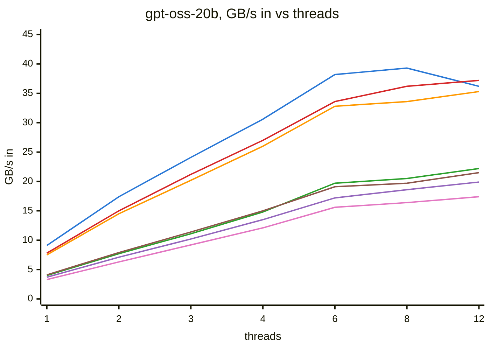
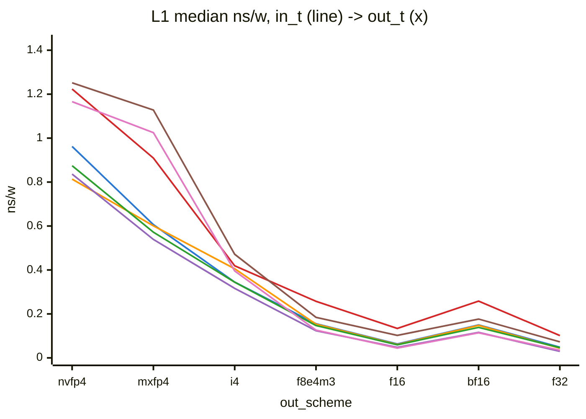

Dequantizer for `.safetensors` in Zig (0.17)

gpt-oss-20b (`openai/gpt-oss-20b`, 12.8 GiB, MXFP4 experts) on Ryzen 5 7600X:

| out_t | 1t | 6t | 12t | GB/s in (6t) | GB/s out (6t) | qw/s (6t) |
|---|---|---|---|---|---|---|
| f32 | 1510 ms | 360 ms | 380 ms | 38.2 | 212.3 | 53.1 G |
| f16 | 1840 ms | 420 ms | 380 ms | 32.8 | 91.0 | 45.5 G |
| bf16 | 3400 ms | 700 ms | 630 ms | 19.7 | 54.6 | 27.3 G |
| f8e4m3 | 3770 ms | 800 ms | 700 ms | 17.2 | 23.9 | 23.9 G |
| f8e8m0 | 1770 ms | 410 ms | 360 ms | 33.6 | 46.6 | 46.6 G |
| i4 | 3390 ms | 720 ms | 640 ms | 19.1 | 13.3 | 26.5 G |
| f4e2m1 | 4210 ms | 890 ms | 790 ms | 15.5 | 10.7 | 21.5 G |

## Usage

```sh
zig build -Doptimize=ReleaseFast -Dcpu=native
./zig-out/bin/dequant ./models/gpt-oss-20b/model*.safetensors f32 8
```

Recognized tensor layouts (`src/safetensors.zig`, `HEADERS`):

| scheme | weight | scale | global scale |
|---|---|---|---|
| NVFP4 (1) | U8 | F8_E4M3 | F32 |
| NVFP4 (2) | U8 | F8_E4M3 | F32 (inv) |
| MXFP4 (3) | U8 | U8 (E8M0) | none |
| INT4 W4A16 (2) | I32 | BF16 | none |
| FP8 (1)(2) | F8_E4M3 | F32 (scalar) | none |
| plain | F32 / F16 / BF16 / F8_E4M3 | none | none |

> 1. https://github.com/NVIDIA/Model-Optimizer
> 2. https://github.com/vllm-project/compressed-tensors
> 3. https://huggingface.co/openai/gpt-oss-20b


## Pipeline

```text
main
  parseJson                         single threaded
  spawn N workers

worker
  incremental atomic counter as shared chunk idx
  read -> dequant -> `doNotOptimizeAway()`

dequant block
  unpack                            lo/hi shuffle
  decode     e_m_ -> f32
  loadScale  e_m_ -> f32            lookup translate
  translate  f32                    RTN | std-affine         
  encode     f32 -> out_t           f32 | f16 | bf16
  pack                              lo/hi shuffle
```
The quantization pipeline is modular through `types.Dtype.RECIPE` and `types.Scheme.RECIPE` which holds type recipies. All threads reuse their buffer, kept via `doNotOptimizeAway`.

## Tests

```sh
zig build test
```

- `dequant: nvfp4`, `dequant: mxfp4`: all 16 E2M1 x 2 scales, bit-exact for f32 / f16 / bf16 (`-0.0` included)
- `safetensors: parseJson`: scale and global scale merged into the weight layer.

## Benchmarks

Setup: Ryzen 5 7600X (Zen 4, 6C/12T), DDR5, Linux 6.18, boost on, EPP balance_performance, zig 0.17. Files warm in page cache. Min of 3 per shard, summed over shards.

```sh
hf download openai/gpt-oss-20b --include "model-*.safetensors" --local-dir models/gpt-oss-20b
./bench/wallmodel.sh models/gpt-oss-20b/model-*.safetensors
```

### Per target

```sh
./bench/target.sh
```

| target | ISA | gpt f32 | gpt f16 | gpt bf16 | kernel nvfp4 ns/w | cyc/block (mca) |
|---|---|---|---|---|---|---|
| x86_64_v1 | SSE2 | 5430 ms | 88330 ms | 7040 ms | 0.2827 | 25.0 |
| x86_64_v2 | SSE4.2 | 5450 ms | 88270 ms | 7040 ms | 0.2909 | 25.0 |
| x86_64_v3 | AVX2+F16C | 2010 ms | 2580 ms | 3340 ms | 0.0785 | 15.0 |
| x86_64_v4 | AVX-512 | 1710 ms | 1930 ms | 2720 ms | 0.0663 | 5.0 |
| native | znver4+GFNI | 1320 ms | 1640 ms | 2330 ms | 0.0439 | 3.0 |

### Thread scaling


- blue: f32
- orange: f16
- green: bf16
- red: f8e8m0
- purple: f8e4m3
- brown: i4
- pink: f4e2m1

### In and Out type permutations



- blue: nvfp4
- orange: mxfp4
- green: i4
- red: f8e4m3
- purple: f16
- brown: bf16
- pink: f32


**Scaling:**

- Reading from userspace cap at 63 GB/s, reached with 3 threads. Then copies start competing for DRAM bus (not on gpt-oss because quantized weight freq is too high)
- Each layer is one work item. A gpt-oss shard has 20 quantized ones. One 253 MiB tensor takes 85 ms on one thread, against 213 ms of ideal work per thread at 6 threads
- `_copy_to_iter` takes 16% of cycles at 1 thread

Caveat: `out_buf` is reused, so output never reaches DRAM. A real f32 consumer writes 8 bytes per byte of quantized input, so it hits the write-bandwidth limit before compute does.

### Kernel vs llama.cpp

Output f32, 1 thread, kernels only (no file read, parse or orchestration). Median ns/weight.

| size | cache | llama.cpp nvfp4 | HEAD nvfp4 | ratio | llama.cpp mxfp4 | HEAD mxfp4 | ratio |
| --- | --- | --- | --- | --- | --- | --- | --- |
| 18 KiB | L1 | 0.2899 | 0.0436 | 6.65x | 0.2656 | 0.0439 | 6.05x |
| 584 KiB | L2 | 0.2924 | 0.0445 | 6.57x | 0.2660 | 0.0446 | 5.96x |
| 18 MiB | L3 | 0.3159 | 0.0455 | 6.94x | 0.2673 | 0.0459 | 5.82x |
| 292 MiB | DRAM | 0.3171 | 0.1427 | 2.22x | 0.2680 | 0.1419 | 1.89x |

```sh
./bench/build.sh
./bench/out/bench_llama nvfp4 && ./bench/out/bench_dequant nvfp4
./bench/out/bench_llama mxfp4 && ./bench/out/bench_dequant mxfp4
```

> llama.cpp kernels from `tests/test-quantize-perf.cpp`, master `ded522f8304554317e7ff8f88698dbbbca5425aa` (2026-11-13). Pinned, 3 trials x 20 s, TSC-timed.

## TODO

- Work item = chunk, not layer
- sort layers for latency tail
- swap `vcvtps2ph`
- more layouts
- gpt-oss-120b (deferred load)
- skip read if unquantized to avoid _copy_to_iter
- tail is dropped
