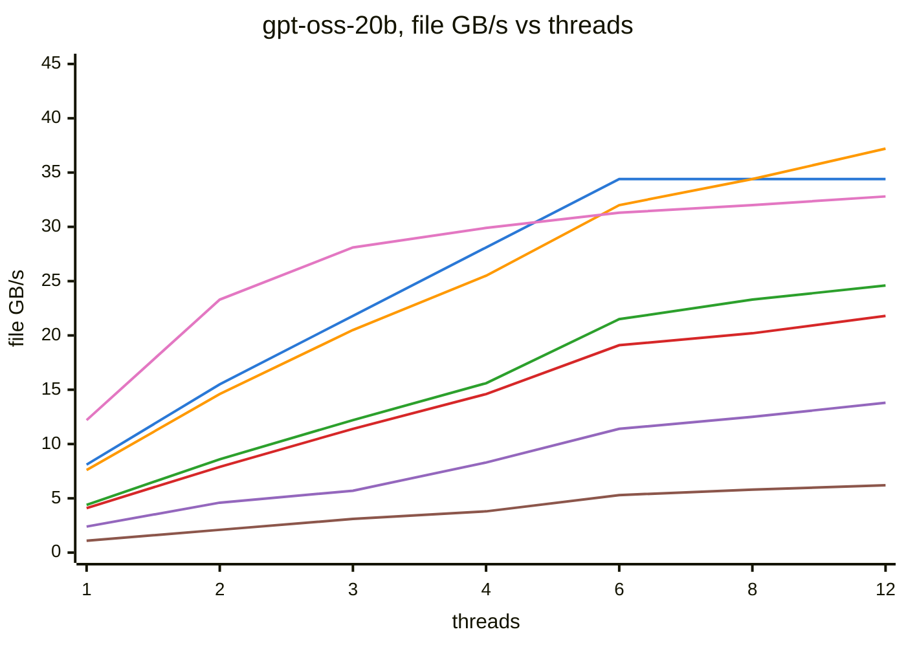
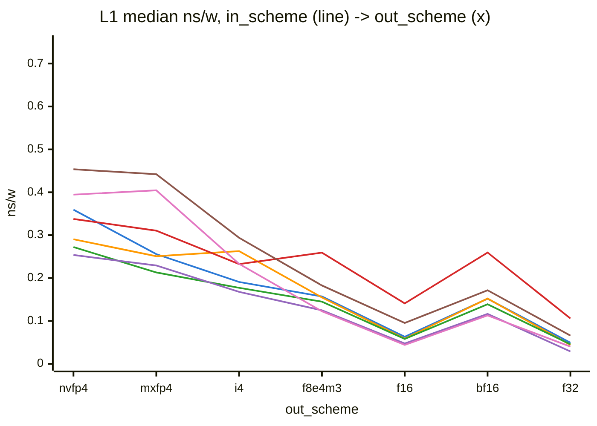

Quantization and dequantization for `.safetensors` in Zig (0.17)

gpt-oss-20b (`openai/gpt-oss-20b`, 12.8 GiB, MXFP4 experts) on Ryzen 5 7600X:

| out_scheme | 1t | 6t | 12t | file GB/s (6t) |
|---|---|---|---|---|
| nvfp4 | 6920 ms | 1450 ms | 1190 ms | 9.5 |
| mxfp4 | 960 ms | 370 ms | 360 ms | 37.2 |
| i4 | 4350 ms | 910 ms | 780 ms | 15.1 |
| f8e4m3 | 3830 ms | 810 ms | 710 ms | 17.0 |
| f16 | 1820 ms | 420 ms | 380 ms | 32.8 |
| bf16 | 3450 ms | 710 ms | 640 ms | 19.4 |
| f32 | 1480 ms | 360 ms | 400 ms | 38.2 |

File GB/s divides total shard size by wall time. For `mxfp4` output, MXFP4 experts pass through and BF16 tensors are quantized.

## Usage

```sh
zig build -Doptimize=ReleaseFast -Dcpu=native
./zig-out/bin/quant ./models/gpt-oss-20b/model*.safetensors f32 8
```

Recognized tensor layouts (`src/safetensors.zig`, `HEADERS`):

| scheme | weight | scale | global scale |
|---|---|---|---|
| NVFP4 (1) | U8 | F8_E4M3 | F32 |
| NVFP4 (2) | U8 | F8_E4M3 | F32 (inv) |
| MXFP4 (3) | U8 | U8 (E8M0) | none |
| INT4 W4A16 (2) | I32 | BF16 | none |
| FP8 (1)(2) | F8_E4M3 | F32 (scalar) | none |
| plain | F32 / F16 / BF16 / F8_E4M3 | none | none |

> 1. https://github.com/NVIDIA/Model-Optimizer
> 2. https://github.com/vllm-project/compressed-tensors
> 3. https://huggingface.co/openai/gpt-oss-20b


## Pipeline

```text
main
  parseJson                         single threaded
  spawn N workers

worker
  incremental atomic counter as shared chunk idx
  out -> `doNotOptimizeAway()`

quant block
  unpack                            lo/hi shuffle
  decode     in_t -> f32
  scaleIn    in_t -> f32            lookup translate
  translate  f32                    RTN | std-affine         
  scaleOut   f32 -> out scales      scaled output only
  encode     f32 -> out_t
  pack                              lo/hi shuffle
```
The quantization pipeline is modular through `types.Dtype.RECIPE` and `types.Scheme.RECIPE` which holds type recipies. All threads reuse their buffer, kept via `doNotOptimizeAway`.

## Tests

```sh
zig build test
```

- `quant: nvfp4`, `quant: mxfp4`: all 16 E2M1 x 2 scales, bit-exact for f32 / f16 / bf16 (`-0.0` included)
- `safetensors: parseJson`: scale and global scale merged into the weight layer.

## Benchmarks

Setup: Ryzen 5 7600X (Zen 4, 6C/12T), DDR5, Linux 6.18, boost on, EPP balance_performance, zig 0.17. Files warm in page cache. Minimum of three runs across all shards.

```sh
hf download openai/gpt-oss-20b --include "model-*.safetensors" --local-dir models/gpt-oss-20b
./bench/wallmodel.sh models/gpt-oss-20b/model-*.safetensors
```

### Per target

```sh
./bench/target.sh
```

| target | ISA | gpt f32 | gpt f16 | gpt bf16 | kernel nvfp4 → f32 ns/w | cyc/block (mca) |
|---|---|---|---|---|---|---|
| x86_64_v1 | SSE2 | 6380 ms | 101190 ms | 15740 ms | 0.3892 | 10.0 |
| x86_64_v2 | SSE4.2 | 6470 ms | 101240 ms | 13520 ms | 0.3882 | 9.7 |
| x86_64_v3 | AVX2+F16C | 2180 ms | 2680 ms | 5290 ms | 0.0815 | 5.3 |
| x86_64_v4 | AVX-512 | 1880 ms | 2090 ms | 3880 ms | 0.0681 | 4.0 |
| native | znver4 | 1480 ms | 1820 ms | 3470 ms | 0.0473 | 3.0 |

Model times are the minimum of up to three runs with a 10 s budget per permutation. Kernel times are medians of three 10 s trials. `cyc/block` is `llvm-mca` block reciprocal throughput on `znver4`, for the executed 16-weight inner loop.

### Thread scaling


- blue: f32
- orange: f16
- green: bf16
- red: f8e4m3
- purple: i4
- brown: nvfp4
- pink: mxfp4 (experts pass through)

### In and Out type permutations

`./bench/matrix.sh L1` runs three 200 ms trials per conversion. `./bench/matrix.sh --full L1` uses three 10 s trials with 2 s gaps. Diagonal zeros mark skipped conversions.



- blue: nvfp4
- orange: mxfp4
- green: i4
- red: f8e4m3
- purple: f16
- brown: bf16
- pink: f32


**Scaling:**

- Reading from userspace cap at 63 GB/s, reached with 3 threads. Then copies start competing for DRAM bus (not on gpt-oss because quantized weight freq is too high)
- Each layer is one work item. A gpt-oss shard has 20 quantized ones. One 253 MiB tensor takes 85 ms on one thread, against 213 ms of ideal work per thread at 6 threads
- `_copy_to_iter` takes 16% of cycles at 1 thread

Caveat: `out_buf` is reused, so output never reaches DRAM. A real f32 consumer writes 8 bytes per byte of quantized input, so it hits the write-bandwidth limit before compute does.

### Kernel vs llama.cpp

1 thread, kernels only (no file read, parse or orchestration). Median ns/weight.

#### Dequantization to f32

| size | cache | llama.cpp nvfp4 | HEAD nvfp4 | ratio | llama.cpp mxfp4 | HEAD mxfp4 | ratio |
| --- | --- | --- | --- | --- | --- | --- | --- |
| 18 KiB | L1 | 0.2902 | 0.0475 | 6.11x | 0.2677 | 0.0480 | 5.58x |
| 584 KiB | L2 | 0.2936 | 0.0531 | 5.53x | 0.2685 | 0.0462 | 5.81x |
| 18 MiB | L3 | 0.3162 | 0.0524 | 6.03x | 0.2673 | 0.0463 | 5.77x |
| 292 MiB | DRAM | 0.3169 | 0.1452 | 2.18x | 0.2676 | 0.1428 | 1.87x |

#### Quantization from f32

| size | cache | llama.cpp nvfp4 | HEAD nvfp4 | ratio | llama.cpp mxfp4 | HEAD mxfp4 | ratio |
| --- | --- | --- | --- | --- | --- | --- | --- |
| 18 KiB | L1 | 0.8990 | 0.4144 | 2.17x | 1.4204 | 0.3940 | 3.61x |
| 584 KiB | L2 | 0.9017 | 0.4079 | 2.21x | 1.4237 | 0.3949 | 3.61x |
| 18 MiB | L3 | 0.9024 | 0.4068 | 2.22x | 1.4238 | 0.3981 | 3.58x |
| 292 MiB | DRAM | 0.9028 | 0.4084 | 2.21x | 1.4231 | 0.3985 | 3.57x |

Sizes use the nvfp4 input and output footprint. llama.cpp quantization uses reference kernels; its harness validates a roundtrip without comparing output bit-for-bit against `quant`.

```sh
./bench/build.sh
./bench/out/bench_llama nvfp4 && ./bench/out/bench_quant nvfp4
./bench/out/bench_llama mxfp4 && ./bench/out/bench_quant mxfp4
./bench/out/bench_llama_quant nvfp4 && ./bench/out/bench_quant f32 nvfp4
./bench/out/bench_llama_quant mxfp4 && ./bench/out/bench_quant f32 mxfp4
```

> llama.cpp kernels from `tests/test-quantize-perf.cpp`, master `ded522f8304554317e7ff8f88698dbbbca5425aa` (2026-11-13). Pinned, 3 trials x 10 s, TSC-timed, with 2 s gaps for multiple sizes and 10 s gaps for a single size.

## TODO

- Work item = chunk, not layer
- sort layers for latency tail
- swap `vcvtps2ph`
- more layouts
- gpt-oss-120b (deferred load)
- skip read if unquantized to avoid _copy_to_iter
- tail is dropped
